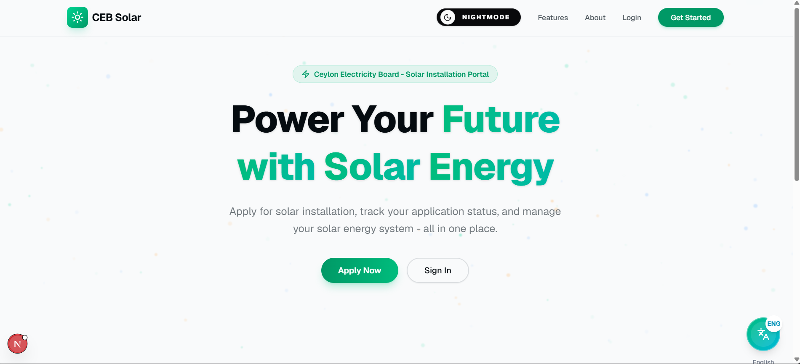
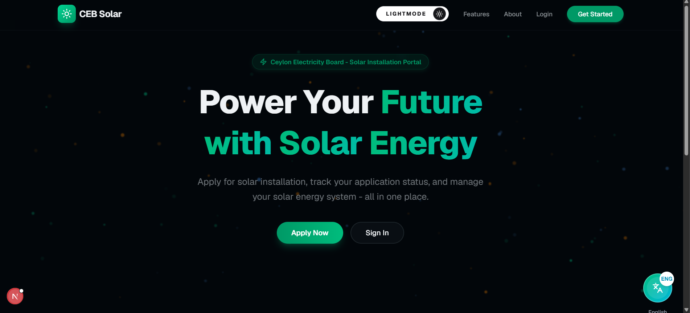
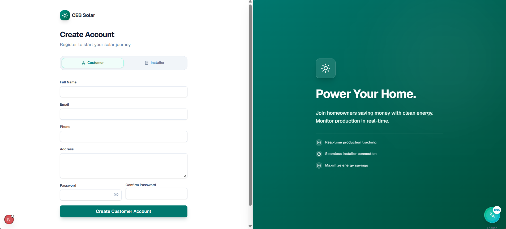
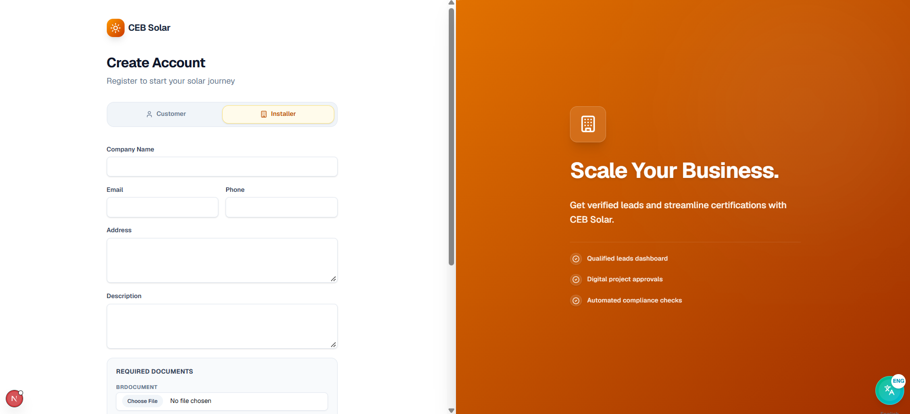
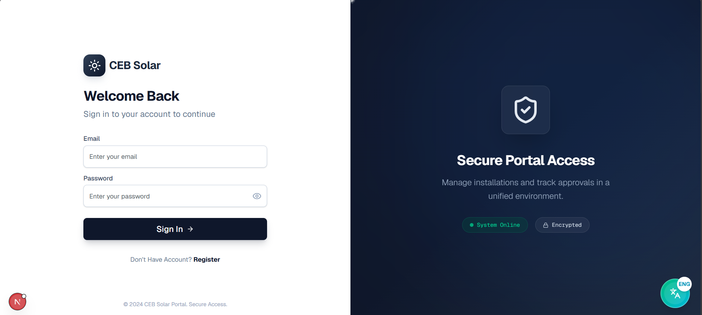
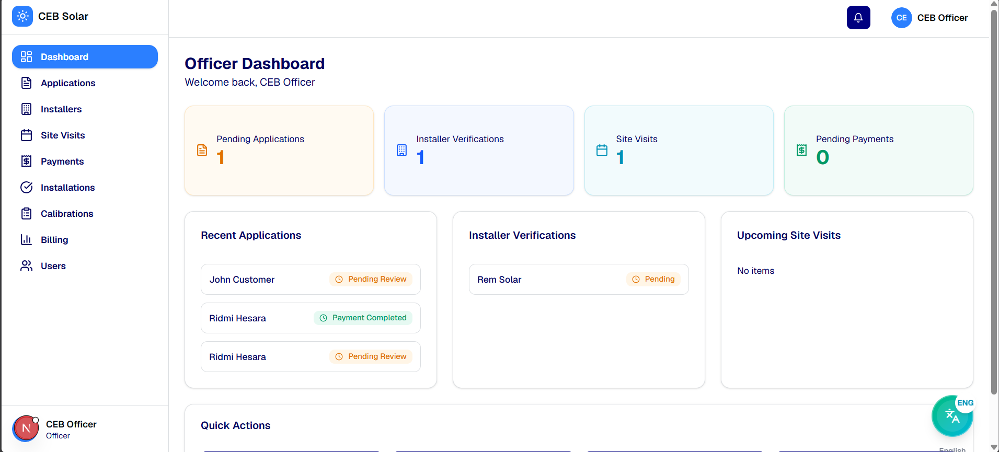
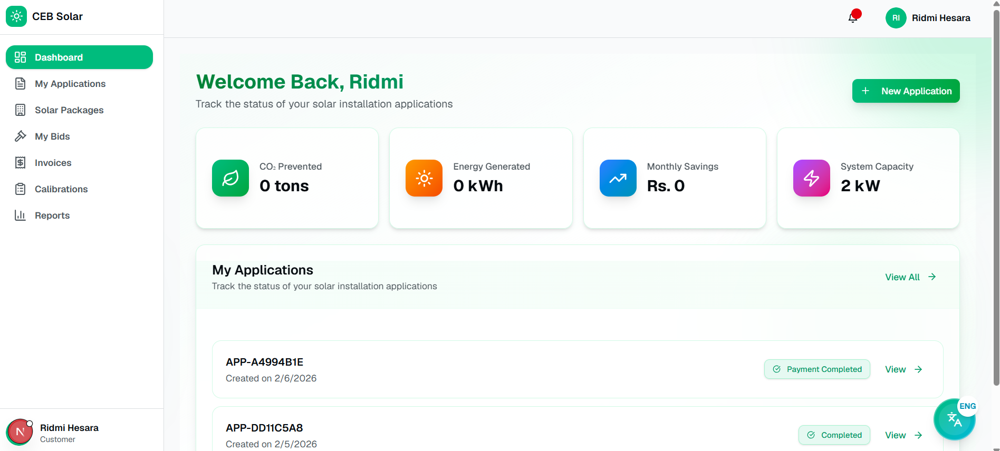
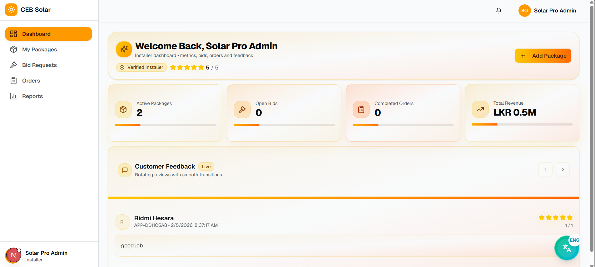
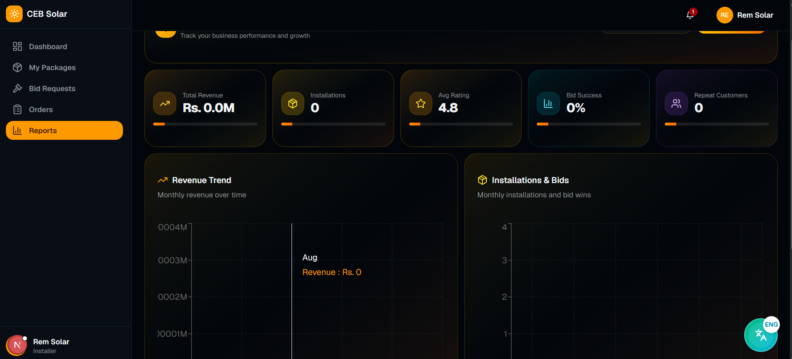

<div align="center">

# ☀️ Solar Connect

### CEB Solar Installation Management Portal

**A role-based solar installation platform connecting customers, solar installers, and CEB officers.**

   

**Academic Team Project · LNBTI · 2026**

</div>

## 📖 Overview

**Solar Connect** (branded **CEB Solar** in the interface) is a web-based portal designed to streamline solar installation applications and related workflows. It brings customers, installers, and CEB officers together in a single system, with role-specific dashboards for tracking applications, managing solar packages and bids, and overseeing installation processes.

The interface includes **light and dark themes** and a language selection control.

> **Note:** This is an academic project, not an official Ceylon Electricity Board service.

## ✨ Core Features

| Area | Features |
| --- | --- |
| 🔐 Authentication | Sign-in and separate customer/installer registration interfaces |
| 👤 Customer portal | Solar applications, status tracking, solar packages, bids, invoices, calibrations, and reports |
| 🏢 Installer portal | Package management, bid requests, orders, customer feedback, and performance reports |
| 🛡️ CEB officer portal | Application review, installer verification, site visits, payments, installations, calibrations, billing, and users |
| 📊 Dashboards | Role-specific summaries, application statuses, revenue and installation metrics |
| 🌗 Appearance | Light and dark modes |
| 🌐 Accessibility | Language selection interface |

*The screenshots demonstrate the available interfaces; individual workflows may require database configuration and test data.*

## 🛠️ Tech Stack

| Layer | Technology |
| --- | --- |
| Framework | Next.js and React |
| Language | TypeScript / JavaScript |
| Styling | Tailwind CSS |
| ORM | Prisma |
| Package manager | npm (project also contains a pnpm lockfile) |
| Database | Configured through Prisma and environment variables; see `prisma/schema.prisma` |

## 📸 Screenshots

### 1. Landing Page — Light Mode


### 2. Landing Page — Dark Mode


### 3. Customer Registration


### 4. Installer Registration


### 5. Sign In


### 6. CEB Officer Dashboard


### 7. Customer Dashboard


### 8. Installer Dashboard


### 9. Installer Reports — Dark Mode


## 🚀 Getting Started

### Prerequisites

- Node.js and npm
- A database compatible with the Prisma schema and configured for your local environment

### Installation

1. Clone the repository:

   ```bash
   git clone https://github.com/ridmi18/Solar-Connect.git
   cd Solar-Connect/final
   ```

2. Install dependencies:

   ```bash
   npm install
   ```

3. Create a local `.env` file in `final/` with the environment variables required by your project. Use placeholder values in any example file, and **never commit real credentials**.

4. Review `prisma/schema.prisma`, configure the database connection, and apply the appropriate Prisma setup for your environment. For a migration-based project, this is commonly:

   ```bash
   npx prisma generate
   npx prisma migrate dev
   ```

5. Start the development server:

   ```bash
   npm run dev
   ```

6. Open **http://localhost:3000**.

> Verify the required environment variables and available npm scripts in your copy of the project before running database commands.

## 📁 Project Structure

```text
Solar-Connect/
├── final/
│   ├── app/
│   ├── components/
│   ├── context/
│   ├── data/
│   ├── hooks/
│   ├── lib/
│   ├── prisma/
│   ├── public/
│   ├── styles/
│   ├── types/
│   └── package.json
├── screenshots/
│   ├── 1.png
│   ├── 9.png
│   ├── 2.png
│   └── ...
└── README.md
```

## 👥 Project Team

| Name | Role |
| --- | --- |
| **Dulmini Gamlath** | Project Leader |
| **Ridmi Hesara** | Team Member |
| **Shamindu Dewranga** | Team Member |

**Supervisor:** Mrs. Hansika Samanthi  
**Institution:** Lanka Nippon BizTech Institute (LNBTI)  
**Year:** 2026

---

<div align="center">

**Solar Connect** · Academic software development project · 2026

</div>
